# SpecWright UI/UX review and design proposals

Date: 2026-11-15 · Branch reviewed: `feature/copy-paste-flow-steps` · Scope: the whole React frontend (`frontend/src`)

This document is a work order for whoever implements the UI improvements (a person or a model). It records what every screen does today, what gets in the user's way, and what to build instead. Nothing here has been implemented.

## Implementation status

Done on 2026-11-15 (frontend only, checked in the mock UI):

| Item | What changed |
|---|---|
| WF-3 | Readiness lists "Spec Kit set up for this project" with a "Set up Spec Kit" link; Run stays disabled until every check passes, with "Needed first: …" next to it. |
| INP-2 | Choose input › Tools: a note when every step has tools off; a warning when the user chose tools that no step gets; "Give tools to every step". |
| HI-1 | History rows count missing usage as 0 and say "in progress" for unfinished runs (no more NaN). |
| X-3 (part) | `toast(msg, kind)`: error toasts (all `toast(errMsg(…))` calls) stay 8 s, have a close button and use `role="alert"`; hovering holds any toast. Banners, inline field errors and the notification list are still to do. |
| FL-2 | Flow header: Save is the only primary button (also ⌘S / Ctrl+S); Run is secondary; Export, Duplicate, Import and Delete are in a `⋯` menu; "Unsaved changes" in the warning color. |
| FL-3 | Problems are a button with an icon; the list closes on Esc or a click outside, and each entry goes to its step. |
| FR-9 / X-8 (part) | The status bar pill counts flow runs; "flow waiting for you" / "flow running" and "approval needed" are buttons that open the run or step; Run flows gets a rail dot while a flow run waits. |
| FR-3 / X-11 (part) | Run flows counts steps like the flow list (no start or output steps). |

New shared pieces: `Menu` and `usePopover` in `ui.jsx`; `.banner.warn`, `.status-btn`, `.menu*` in `styles.css`.

Second round (2026-11-15):

| Item | What changed |
|---|---|
| X-4 | `PaneHandle` (`ui.jsx`, wrapped by `Pane.jsx`): drag, ←/→ (⇧ for bigger steps), double-click or Home resets; widths saved in prefs (`panes`). Used by Workflow, Tools, Playground, Files, History, Flow step guide, Run flows (both sides) and the Flow designer (list, palette, inspector). Grids read `--pane-l`, `--pane-r`, `--pane-pal`, `--pane-insp`. |
| FL-1 | Flow list, palette and inspector each collapse (⌘\ toggles the inspector); the header flow menu also has New flow with AI and Paste as a new flow. Canvas toolbar: undo, redo, zoom, Fit (F). |
| FL-7 | Undo/redo of canvas and inspector edits (⌘Z, ⇧⌘Z / Ctrl+Y), 60 steps per flow; the delete toast says so. |
| X-10 (canvas) | Steps are focusable (Tab), selected on focus; arrows move (⇧ ×5); C then Tab and Enter connects; Esc cancels. |
| X-10 / OV-1 (modals) | `a11y.js`: Tab stays in the top `aria-modal` dialog, focus outside is pulled back, and focus returns to where it was when the last dialog closes. |
| OV-2 | Permission prompt: copy button on the command or path. |
| OV-3 | Secret prompt: show/hide per value; empty values get an inline error instead of a toast. |
| WF-4 / WF-5 | Approval banner is sticky; "Request changes…" opens the feedback field inside the banner (Send and rerun, ⌘Enter); Reject asks first. |
| X-1 | Sidebar with labels (open by default from 1280 px, toggle saved), workflow progress `n/7`, Spec Kit tick, Flow step guide listed under the designer. |
| X-2 (part) | Command palette ⌘K / Ctrl+K (views, open flow, run flow, sidebar labels); ⌘1…⌘9 go to views. |
| FR-1 / FR-2 | Run options summary shows the non-default values; run lists use relative times (full time in the tooltip), also in History. |
| HI-2 / HI-5 | Short run id with a copy button; empty History offers "Run a workflow step" and "Run a flow". |
| FI-2 | File tree filter; `.codegen` starts collapsed. |
| AD-1 / AD-2 | Passphrase length and match checked as you type; "Unlock admin mode" link focuses the passphrase field. |
| ME-3, FL-9 | "Analyze" label in Metrics; guide examples saved twice are named "(2)", "(3)". |

Third round, cross-cutting (2026-11-15):

| Item | What changed |
|---|---|
| X-9 / AP-1 | "Appearance" is now **Settings** (view id unchanged) with tabs: Appearance · Agent and model · Runs (housekeeping, workflow budgets, retries, gates) · Network and packages. `openSettings(tab)`; the status bar and the housekeeping "change" link open the right tab. The old places keep their controls. |
| X-8 | Status bar items are buttons: tokens → Metrics, agent → Settings › Agent and model, workspace → Choose input, theme → Settings, admin lock state → Admin. |
| X-3 | Recent messages: the last 20 toasts, under a bell on the status bar with an unread count (red when an error is unread). |
| X-6 (part) | `a11y.js installTooltips`: every `title` shows a styled tooltip after 400 ms on hover and at once on keyboard focus, linked with `aria-describedby`. Text links as buttons are unchanged. |
| X-5 (part) | No text under 11 px: 56 small `font-size` rules now have an 11 px floor (`max(11px, …)`); lifecycle SVG labels are left as they were (user units). Inline code breaks only when it does not fit (`overflow-wrap: anywhere`). No `--fs-*` token scale yet. |
| X-7 / X-11 (part) | `EmptyState` in `ui.jsx`, used in Tools (no match: Clear the search, Create a tool), Playground, Run flows (Design a flow, Try an example), Metrics, Admin, plus History earlier. |

Fourth round, screen by screen (2026-11-15):

| Item | What changed |
|---|---|
| WF-1 (part) | The Lifecycle card can be hidden (remembered); hidden, it is one line and Run moves up about 200 px. Start next iteration stays available. |
| WF-8 | Viewing a locked step shows one banner: "Plan is locked until Clarify is approved…" with "Go to <current step>". |
| WIZ-2 | Each Build rules row says what it builds from (corporate libraries, project skills and scripts, folder structure). |
| INP-1 (part) | Summary bar at the top of Choose input (Spec Kit, diagrams, model, skills, steps with tools); each item jumps to its card. |
| TL-2 | The tool's Tags field sits under the tool heading, not above it. |
| FL-5 (part) | One filter at the top of the palette for steps and tools. |
| FL-10 | Secret inputs show a lock on the Inputs step, with the source in the tooltip. |
| FR-7 / FR-8 | A finished run shows its outputs before the steps list; each review tab has a one-line hint. |
| FI-1 | Ask AI is a resizable side panel next to the code (stacked above it under 1100 px), and can be hidden and shown again. |
| HI-4 | Replay: previous/next buttons, Space plays or pauses, ←/→ step, the current event type is shown. |
| AP-3 | Text size slider with tick labels and "Reset to 13px". |
| AD-3 | A pasted admin public key is checked as base64 and shown as a short fingerprint before Trust is enabled. |

Fifth round, larger reworks (2026-11-15):

| Item | What changed |
|---|---|
| WIZ-1 | The wizard shows one section at a time with Back / Next; the section list shows counts; "Show all sections" (remembered) brings back the single scroll. |
| PG-1 | Playground: the full prompt box (examples, notes) for a new prompt; while a run is open, a compact prompt box is docked at the bottom with Stop, Refer to earlier runs, tools, and "Continue from this run". |
| TL-3 | Tool Review step in tabs: Overview (name, description, parameters), Script, Output shape, Dependencies, Secrets, with counts; Back / Next stay at the bottom. |
| FL-8 | "New flow with AI" over the canvas is a centered dialog (Esc closes); on the empty page it stays inline. |
| FL-6 (part) | Ports have a larger hit area; while connecting, every input port is highlighted. |

Still open: X-3 banners in other views, X-5 `--fs-*` token scale, X-6 text links to icon buttons and `Menu` rollout, X-11 shared `Tabs`/`Field`, WIZ-3…6, INP-1 (collapsed tool groups), INP-3/4/5, WF-1 (one compact stepper), WF-2/6/7, TL-1, TL-4…7, PG-2…5, FL-4, FL-5 (hover cards, recent tools), FL-6 ("+" on ports), FL-11, FR-4/5/6, FG-1/2, FI-3/4/5, HI-3, ME-1/2/4, AP-2/4, AD-4, OV-4/5/6.

## 0. How to use this document

1. Read section 1 (rules) and section 2 (the app today). Section 2.3 is the **functionality inventory**: every feature the UI offers. No change may remove, hide behind admin mode, or break anything in it.
2. Pick work from section 6 (phased plan). Each item points to a proposal id (`X-…` for cross-cutting, or a screen prefix such as `WF-…`).
3. Each proposal gives the problem with evidence, the change, what must stay, and how to tell it is done.
4. After each change, re-capture the screenshots (section 7) and compare them with the ones in `screenshots/`.

How the evidence was gathered: every view was opened in the mock UI (`npm --prefix frontend run dev`, http://localhost:5173) at 1440×900, and selected views at 1280×720, 1024×700 and 820×700, in dark and light themes. Source files were read for labels, layout rules and keyboard handling. Limits of the review are listed in section 8.

## 1. Rules for every change

- **Keep every feature.** Section 2.3 is the checklist. Moving a control is fine; dropping one is not. Where a proposal moves something, it says where it goes.
- **Keep the security wording and behavior.** Secrets are never stored by the app or sent to the model; admin-managed items are read-only until admin mode is unlocked; a tool needs approval before agents may use it. Do not shorten texts that explain these to the point where the promise is lost.
- **Use the existing theme tokens** (`--bg`, `--surface`, `--border`, `--fg`, `--muted`, `--faint`, `--focus`, `--ok`, `--warn`, `--error`, `--info`, `--link`, `--radius`, `--gap`, `--pad`, `--font-ui`, `--font-mono`). No hard-coded colors: there are 3 theme families and 5 skins, and every screen must work in all of them.
- **No new runtime dependencies** unless a proposal says so. The app is React 19 with a hand-written store (`store.js`), plain CSS (`styles.css`) and esbuild.
- **The mock backend must keep working** (`mockBackend.js`): it is how the UI is developed and screenshotted.
- **Desktop app first.** The window is resizable; design for 1024×700 as the smallest comfortable size and 1280×720 to 1920×1080 as the common range. Below 860 px only needs to stay usable.

## 2. The app today

### 2.1 Shell

`App.jsx` lays out a 48 px icon rail, the main area and a 24 px status bar (`.app` grid, `styles.css:33`). There is no router: `S.view` in `store.js` selects the view and is saved in `localStorage` (`codegen.prefs.v1`).

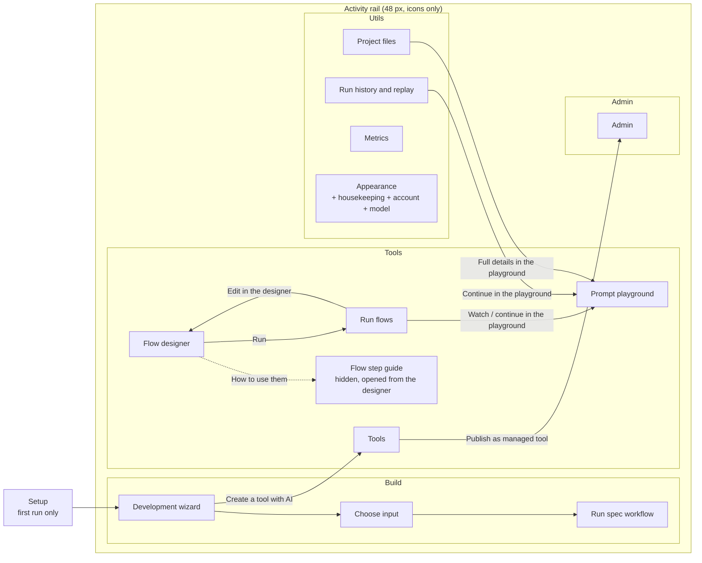

Overlays, available from any view: rules editors (side drawer and bulk editor), library/skill/script editor, secret prompt, permission prompt, file preview panel, run picker, confirm/ask dialogs, toast (bottom right, 3.2 s).

### 2.2 Main journeys

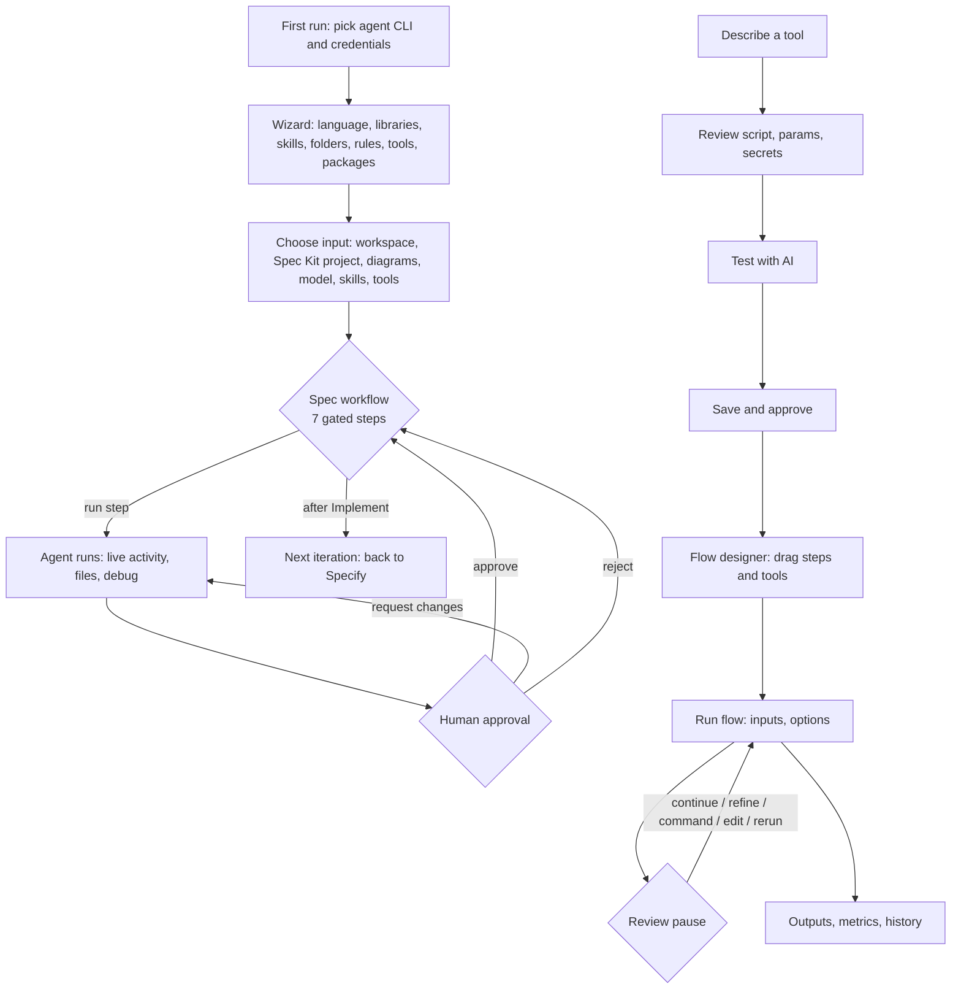

### 2.3 Functionality inventory (must keep)

Every row is existing behavior. Treat the list as a regression checklist.

| View (file) | Functions |
|---|---|
| **Setup** (`views/Setup.jsx`) | Scan the computer for agent CLIs and credentials; scan again; choose a found agent ("Use this"); paste a token; skip for now. |
| **Shell** (`App.jsx`) | Rail navigation in four groups; brand mark goes to the workflow; badge on the workflow icon when approval is needed; status bar: run state pill, workflow step, approval needed, tokens, cost, tool count, agent, workspace, theme name, backend kind; toast. |
| **Development wizard** (`views/Wizard.jsx`, `Packages.jsx`, `CopilotExts.jsx`) | Open/browse a workspace folder. 1 Language chips and build tool. 2 Corporate libraries: select, view, admin: new/publish. 3 Project skills and scripts: select, add script or file/doc to a skill, edit, delete, new skill, new script. 4 Folder structure: five editable paths. Build rules: incremental or bulk load, Build. 5 Functionality rules: incremental or bulk edit, add, edit, remove, export, import, download .md / rich text. 6 Tools and extensions: tiles by source (managed, project, global, Copilot extensions), view/edit/review, load a Copilot extension into the project, create a tool with AI, write a script. 7 Packages and proxy: HTTPS/HTTP proxy, no-proxy, CA bundle, npm, pip, Go, Maven settings, "also use for workflow runs", save, check connections (result table). Section list on the left; "Next: choose input". |
| **Choose input** (`views/Inputs.jsx`, `ProjectPicker.jsx`) | Workspace folder and Open; Spec Kit: project picker and "+ New project", agent integration, set up / refresh / add integration, download Spec Kit, check for newer release, download project zip, "What it sets up", result summary; context/activity diagram and sequence diagram (choose file, pick workspace file, preview, remove); AI model for workflow steps; select skills, libraries, rules (All/None per group); tools: which steps get tools, global/project/built-in tools by category, reset to all approved; "Next: run spec workflow". |
| **Spec workflow** (`views/Workflow.jsx`) | Step list (7 steps) and lifecycle diagram, both clickable; project picker; model picker; per step: inputs, instructions, "Use template", five context toggles; readiness checks; command preview and "Show full prompt"; Run; Cancel run; approval banner (approve and continue, request changes with feedback, reject); "Start next iteration"; download whole project; loop warning; resume notice after the app closed mid-run; Run settings (token budget, cost budget, premium requests, retries, approval gate per step); result tabs: activity, files changed (open file), debug events (copy JSONL, download); usage stats and context-used meter; credential wait state. |
| **Tools** (`views/Tools.jsx`, `Builtins.jsx`, `CopilotExts.jsx`, `ToolTile.jsx`) | Search (name, description, #tag); group by source or tag; "+ New"; 4-step editor: Describe (prompt, examples, connects-to, runtime, generate with AI or write myself), Review (name, description, parameters, output shape, dependencies, secrets with source and "forget remembered value", permissions, command template, script, "Ask AI to change something"), Test with AI (prompt, attachments, auto-fix up to N, tool call, output, fix with AI, review changed script, learn output shape), Save (scope project/global, approval, tags, publish as managed tool with version, runtime, signature); delete; approve for agents; built-in tool page (what the agent is told, parameters, try it with JSON arguments, reset example, machine-policy off state); Copilot extension page (folder, entry, files, packages, load into project, view copies, delete from project, tools it adds, share). |
| **Prompt playground** (`views/Playground.jsx`, `RunHousekeeping.jsx`) | Run list with search, active/archived, select, group, archive, restore; "+ New"; prompt with ⌘/Ctrl+Enter; model; attachments (file, clipboard, drop); "Also offer project and admin tools"; refer to earlier runs (picker); stop; live result, tool usage, usage; reply to an AI question; permission wait; continue this conversation; open full activity, files changed and raw events; watch a flow run. |
| **Flow designer** (`views/Flows.jsx`) | Flow list, "+ New", "New flow with AI" (prompt, examples, model, design options with trial run on sample data, pick one), paste flow, import, export, duplicate, delete, save; flow settings: name, description, version, minutes saved, interface (inputs/outputs, copy as JSON Schema), custom context with attachments, skills. Palette: 9 step types (AI prompt, Merge, Transform, Loop, Gather, Decision, Filter, Aggregate, Output), tool filter, project tools, built-in tools; drag to canvas or click to add after the selection. Canvas: move, connect by dragging ports, multi-select with a band, group move, delete, copy/paste steps (⌘C/⌘V, also across flows), select all, zoom. Inspector per step type: title, step id, note, pause for review, copy, delete, duplicate, copy to a new flow; Inputs step: typed inputs (text, long text, number, choice, yes/no, file, secret with source ask/keychain/env/auto, save value now), label, default, required, help; Tool step: tool, exact values or AI-built arguments, data panel (gets/gives, click a field to insert), try with sample data; AI step: prompt, model, expected reply; Merge; Loop (split, pattern, limit, skip repeats, keep going on failure); Gather; Transform; Decision (paths, conditions, groups, first or every match, otherwise); Filter; Aggregate (group, values, window, sort); Output (format md/txt/html/csv/json, content, actions: save to file, call a tool, copy to clipboard, show; HTML preview). Problems list and per-node error badges; edge selection and path naming. |
| **Run flows** (`views/FlowRun.jsx`) | Flow and run list (runs nested under flows); inputs form incl. attachments and secrets (session or keychain); options: pause for review mode, repeat N times, run once per item (lines/JSON/CSV, pattern, limit), start time, run time limit, step time limit, stop after step, skip steps; model for AI steps; Run flow; Stop; review panel: continue, continue without more reviews, stop, refine with AI (optionally save to the flow), run a command on the result, edit the result, change settings and run again; "what should it give instead" fix with suggested change (apply to flow, discard); steps list with status and timing; AI-chosen arguments; outputs (preview, copy, show in Finder); activity and debug log; progress ring and metrics; watch/continue in the playground; run again; edit in the designer. |
| **Flow step guide** (`views/FlowGuide.jsx`) | Per-step explanation, when to use, settings, examples with live preview, "Try it in the designer" (saves an example flow). |
| **Project files** (`views/Files.jsx`, `FileView.jsx`) | File tree; file viewer with syntax highlight, zoom, copy, rendered preview/raw toggle; Ask AI (prompt, 5 quick prompts, model, stop, clear, answer with file links, usage, full details in the playground); Compile project and "Compile again when the AI changes files"; compilation output. |
| **History** (`views/History.jsx`, `RunHousekeeping.jsx`) | Search; active/archived; select, group, archive, restore; housekeeping note with "change"; replay with play, speed, scrubber; run stats; activity, files changed, debug tabs; continue in the playground; copy run id; show in Finder. |
| **Metrics** (`views/Metrics.jsx`) | Range: 24 h, 7 d, 30 d, all time, last N units, custom from/to; stat groups (this project, all time, flows); hours saved by step; flows by runs; recent runs; download CSV. |
| **Appearance** (`views/Appearance.jsx`) | Match system; theme families GitHub / Copilot / Android with variants (incl. colorblind and high contrast); own seed color and brightness; style (skin): Workbench, Console, Paper, Material, Copilot; interface and code font; text size; housekeeping (auto-archive days for playground and history); account: agent, app-wide model, change agent or credentials. |
| **Admin** (`views/Admin.jsx`) | Become admin (name, passphrase twice); unlock; lock; managed tools: list, retire, new with AI, write myself; built-in tools; trusted admins: add (name, public key), remove; copy own public key; download `policy.json`. |
| **Overlays** | Secret prompt (provide and run, don't provide, remember for session, save in keychain); permission prompt (allow once, allow for this run, deny with reason); file preview panel (back, copy path, open in Files, close); model picker (search or type a name); rich editor (bold, italic, code, link, heading, lists, quote, code block, undo/redo, Markdown source); dialogs. |

## 3. Cross-cutting findings and proposals

Severity: **A** blocks or misleads users, **B** slows them down daily, **C** polish.

### X-1 Navigation: the rail is icons only (B)

**Problem.** Twelve destinations are shown as 20 px icons with labels only in `title=` tooltips ([02-wizard](screenshots/02-wizard.png)). Several icons are close in meaning: wand (wizard), folder (inputs), branch (workflow), nodes (flow designer), play (run flows). The group captions are 9–10 px. The "Flow step guide" has no rail entry. New users cannot tell where they are in the Build sequence.

**Proposal.** Make the rail expandable.

```
collapsed 48 px (today)        expanded 208 px (new default ≥ 1280 px wide)
┌────┐                         ┌──────────────────────────┐
│ ◧  │                         │ ◧ SpecWright          «  │
│BUILD                         │ BUILD                    │
│ ✎  │                         │ ✎  1 Set up project   ✓  │
│ ▢  │                         │ ▢  2 Choose input     ✓  │
│ ⑂ ●│                         │ ⑂  3 Run workflow   ● 1/7│
│TOOLS                         │ TOOLS                    │
│ 🔧 │                         │ 🔧 Tools                 │
│ 💬 │                         │ 💬 Playground            │
│ ⧉  │                         │ ⧉  Flow designer         │
│ ▷  │                         │ ▷  Run flows        ● 1  │
│ ...│                         │ ...                      │
└────┘                         └──────────────────────────┘
```

- A toggle (and `⌘B` / `Ctrl+B`) switches between collapsed and expanded; the choice is saved in prefs. Below 1100 px it starts collapsed.
- Expanded rows show the label, and for Build the step number and a done tick (profile saved, Spec Kit set up, workflow progress `n/7`).
- Badges: workflow (approval needed, exists today) and Run flows (count of runs waiting for review, new).
- The Flow step guide becomes a visible child of Flow designer when expanded.
- Rename for clarity, labels only: "Development wizard" → "Set up project" (keep "Development wizard" as the page title), "Appearance" → "Settings" (see X-9).

**Must keep.** All 13 views reachable; the brand mark shortcut; the approval dot; the `material` skin's pill indicator.

**Done when.** Every destination is readable without hovering at ≥ 1280 px; state survives a restart; all five skins render both rail states.

### X-2 Command palette and global shortcuts (B)

**Problem.** Shortcuts exist only inside single views (⌘Enter to run in Playground, Files, LibraryEditor, AI designer; ⌘S in LibraryEditor; ⌘A/C/V on the flow canvas; Esc in modals). There is no way to switch views, open a flow or a tool, or approve a step from the keyboard, and shortcuts are not shown anywhere except some placeholders.

**Proposal.**
- `⌘K` / `Ctrl+K` opens a command palette: go to view, open flow by name, open tool by name, open file by path, run current step, approve, toggle theme, toggle rail. Build it on the `ModelPicker` popover pattern (search field, arrow keys, Enter).
- `⌘1`…`⌘9` switch views in rail order; `⌘,` opens Settings.
- `⌘S` saves in the Flow designer and the tool editor; `⌘Enter` runs the primary action of the view everywhere (workflow step, flow run, tool test).
- A "Keyboard shortcuts" sheet (`?` or from the palette) lists them; primary buttons show the hint in their tooltip.
- Put all bindings in one module (`shortcuts.js`) so views register handlers instead of adding `window` listeners.

**Must keep.** Existing view-local shortcuts; no shortcut fires while typing in an input unless it uses ⌘/Ctrl.

### X-3 Feedback: toasts carry too much (A)

**Problem.** About 70 messages go through one transient toast (3.2 s, bottom right, `App.jsx:116`), including errors that explain what to do next. Example found during the review: pressing **Run /speckit.constitution** in a project without Spec Kit shows "this project is not set up for Spec Kit yet: use Set up Spec Kit on Choose input first" for 3 seconds and then nothing; the Run button was enabled and the readiness row showed no failing check. Validation errors ("Step ids start with a letter…", "Type a prompt first.") also disappear before they can be read.

**Proposal.** Three levels, chosen by what the user must do:

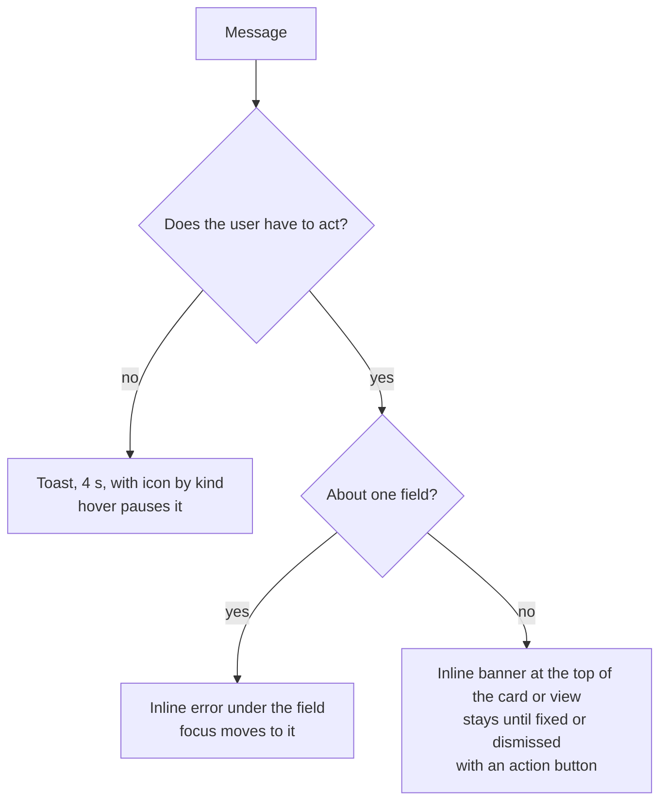

- Add `kind` to `toast()` (`info`, `ok`, `warn`, `error`); errors stay 8 s and get a close button; keep a list of the last 20 in a "Notifications" popover on the status bar.
- Turn blocking errors into banners with a button that goes to the fix ("Set up Spec Kit" → Choose input). The workflow approval banner is the model to copy.
- Preconditions belong in the readiness row (WF-3), with the Run button disabled and the reason next to it.
- Use `role="alert"` for errors, `aria-live="polite"` for the rest (the toast is polite today).

**Done when.** No message that asks for an action is shown only as a toast; every disabled primary button has a visible reason.

### X-4 Layout: fixed panes and narrow windows (A at ≤ 1100 px, B otherwise)

**Problem.** Side panes have fixed widths (`.wf` 260, `.files` 300, `.hist` 320, `.flows` 230, `.fl-work` 210/1fr/340, `.frun` 250/1fr/270; `styles.css:255–800`) and cannot be resized or collapsed. Evidence:
- At 1024 px the workflow lifecycle diagram is cut off after "Plan" with no scroll hint ([08-workflow-1024](screenshots/08-workflow-1024.png)).
- At 1024 px the flow canvas is about 540 px wide ([20-flows-1024](screenshots/20-flows-1024.png)); at 1280×720 it shows two steps ([21-flows-1280x720](screenshots/21-flows-1280x720.png)).
- Long file names and run titles are truncated in lists with no way to widen them ([27-files-ask-ai](screenshots/27-files-ask-ai.png), [13-playground](screenshots/13-playground.png)).

**Proposal.**
- One `SplitPane` component: drag handle (4 px hit area 8 px), double-click resets, min/max widths, collapse button, sizes saved per view in prefs. Use it for every list/detail and three-pane view.
- Flow designer: palette and inspector collapse to a 36 px strip with an icon; `⌘\` toggles the inspector. The flow list moves into a header dropdown at all sizes (it already becomes a select under 1100 px), giving the canvas 230 px more.
- Lifecycle diagram: scale to fit the container (`viewBox`, min 640 px) and switch to a compact stepper under that (WF-1).
- Add container-based rules instead of the six unrelated breakpoints (700/760/860/1100/1250/1280): define `--bp-compact: 1100px` and `--bp-narrow: 860px` and use only those.

**Done when.** At 1024×700 no content is clipped without a scrollbar or a hint, and the flow canvas is at least 600 px wide with both side panes open.

### X-5 Density, type scale and text length (B)

**Problem.**
- Font sizes of 9, 9.5, 10, 10.5, 11 and 11.5 px are used for captions, badges and help text at a 13 px base (`styles.css`). Help paragraphs in `--muted` run to three lines in many cards ([04-inputs-full](screenshots/04-inputs-full.png), [10-tools-review-full](screenshots/10-tools-review-full.png)).
- Inline code chips break in the middle of a word: `/specki` / `t.constitution`, `/speckit.constitutio` / `n` ([05-workflow-idle-full](screenshots/05-workflow-idle-full.png)), `.codegen/tools/pro` / `ject/find-todos/`.
- Pages are long single scrolls: the wizard is about 3,300 px tall and Choose input about 2,000 px ([03-wizard-full](screenshots/03-wizard-full.png), [04-inputs-full](screenshots/04-inputs-full.png)).

**Proposal.**
- Type scale tokens relative to the user's text size: `--fs-xs: 0.85em` (min 11 px), `--fs-sm: 0.92em`, `--fs-md: 1em`, `--fs-lg: 1.15em`, `--fs-xl: 1.4em`. Replace every px font size; nothing renders under 11 px at the default size.
- `code` chips: `white-space: nowrap` up to 32 characters, `overflow-wrap: anywhere` only beyond that, and never split after a `/` or `.` followed by fewer than 3 characters.
- Help text: first sentence visible, the rest behind a "More" disclosure or an info popover (`?` icon with `aria-describedby`). Keep the full wording; only its placement changes. Security texts (rule in section 1) stay fully visible.
- Long pages: see WIZ-1 and INP-1 (one section at a time, with a summary).

### X-6 Buttons and action hierarchy (B)

**Problem.** Headers hold many buttons of equal weight. Flow designer: Flow settings, Run, Export, Duplicate, Delete, Save, with Delete next to Save and the primary color on Run and Save both ([15-flows](screenshots/15-flows.png)). Text links are used as buttons for Edit, Delete, Remove, View, Copy, All, None ([03-wizard-full](screenshots/03-wizard-full.png)); "Delete" and "Edit" are 12 px apart. Icon buttons rely on `title=` (132 uses).

**Proposal.**
- One primary button per view header. Secondary actions stay as buttons; rare or destructive ones go into an overflow menu (`⋯`): Export, Duplicate, Delete, Import.
- A `Menu` component (button + popover list, arrow keys, Esc) and an `IconButton` component that requires `aria-label` and renders a real tooltip on hover and focus (300 ms delay) instead of `title`.
- Row actions: icon buttons with at least 28×28 px targets, destructive ones separated and confirmed (confirm dialogs exist: `Dialog.jsx`).
- Button variants as classes: `.primary`, `.default`, `.quiet`, `.danger`; remove inline `style={{}}` used for spacing and color (Tools 35, Flows 28, Workflow 26 occurrences) in favor of utility classes.

### X-7 Empty, loading and error states (B)

**Problem.** Empty states are one line of text ("No runs recorded", "Pick a run", "No tools yet. Create one on the Tools screen.") without an action ([28-history-empty](screenshots/28-history-empty.png)). Loading is the word "Loading…". The Flow designer's good empty hint ("Start by dragging a tool or step here") shows what the others could be.

**Proposal.** An `EmptyState` component: icon, one-line title, one sentence, primary action, optional secondary link. Apply to: History (→ "Run a workflow step" / "Run a flow"), Playground list, Run flows without flows (→ "Design a flow", "Try an example"), Tools search with no match (→ "Clear search", "Create a tool"), Files without a workspace, Metrics without runs, Admin lists, wizard rules and skills. Use skeleton rows for lists and the existing `Spinner` for actions; show "Loading…" text only after 400 ms.

### X-8 Status bar (C)

**Problem.** Items are plain 11 px text and none can be clicked. The state pill reflects only the spec workflow: it read "Idle" while a flow run was waiting for review ([24-flowrun-review](screenshots/24-flowrun-review.png)). "browser preview · mock backend" and the theme name take space that state could use.

**Proposal.**
- Each item is a button: state pill → the view that needs attention; workflow step → Run spec workflow; agent → Settings › Account; workspace → Choose input (tooltip: full path, "Reveal in Finder"); theme → Settings; tokens/cost → Metrics.
- The pill shows the most urgent state across workflow, flow runs, playground and Ask AI: `Waiting for you` > `Running` > `Failed` > `Idle`, with a count when several.
- Add the notifications button (X-3) and the admin lock state.

### X-9 Settings are split in surprising places (B)

**Problem.** "Appearance" also holds housekeeping (auto-archive), the account/agent and the app-wide model ([32-appearance-full](screenshots/32-appearance-full.png)). Run budgets are in a collapsed "Run settings" in the workflow sidebar. Proxy and registries are step 7 of the wizard. The model can be set in six places (app-wide, workflow, Choose input, flow AI steps, playground, Ask AI) and each picker says only "CLI default".

**Proposal.** Rename the view to **Settings** with tabs: Appearance · Agent and model · Runs (budgets, retries, approval gates, housekeeping) · Network and packages (the `Packages` component, also still shown in the wizard as step 7) · Shortcuts. Existing places keep a link ("Run settings ›") that opens the right tab, so nothing has to be relearned. Each model picker shows where its value comes from: `CLI default · from app setting`, with "Change app default" in the popover.

### X-10 Accessibility (A for keyboard-only users of the flow canvas, B otherwise)

**What works.** A global `:focus-visible` ring; `prefers-reduced-motion` handled for the main animations; `role="dialog"` on modals; colorblind and high-contrast themes; lifecycle nodes are focusable with `aria-label`.

**Problems.**
- The flow canvas needs a mouse for moving and connecting steps. Keyboard users can add a step from the palette (Enter) but cannot connect, reorder or position.
- Status is often color plus small text (node error badge, pills). Pills do carry text, which is good; edges and ports rely on color alone.
- Modals do not trap focus consistently, and focus does not always return to the trigger (check `SecretPrompt`, `PermissionPrompt`, `RulesEditors`, `LibraryEditor`).
- Only three `aria-live` regions exist; run progress and step status changes are not announced.
- Contrast of `--muted` on `--surface` and of `--faint` text was not measured for all 20+ themes (section 8).

**Proposal.**
- Canvas keyboard model: Tab moves between steps in flow order; arrows move the selected step by one grid unit (Shift: 5); `C` starts "connect from here", arrows/Tab pick the target, Enter confirms; `Delete` removes; a "Steps" outline list in the inspector mirrors the graph for screen readers.
- A shared `Modal` wrapper: focus trap, Esc, focus return, `aria-labelledby`.
- `aria-live="polite"` on run status lines (workflow, flow run, tool test).
- A contrast check script over `themes.generated.js` that fails when body text is under 4.5:1 or muted text under 3:1.
- Minimum target size 24×24 px (28 preferred) for every clickable control.

### X-11 Consistency and shared components (C, enables the rest)

**Problem.** The same pattern is built several times: list + detail layouts, attachment rows, "All / None" selectors, tabs, steppers, stat tiles, review banners. Border radii in use: token, 3, 4, 5, 6, 8, 10, 12 px and pills. Flow step counts differ between screens for the same flow: "5 steps" in the list and "7 steps" beside Run ([23-flowrun-setup-options](screenshots/23-flowrun-setup-options.png); `FlowRun.jsx:226` counts all nodes but the start node, the list excludes outputs).

**Proposal.** Add to `ui.jsx`: `SplitPane`, `Menu`, `IconButton`, `Tooltip`, `Tabs`, `Stepper`, `EmptyState`, `Banner`, `Field` (label, help, error), `Modal`, `Toolbar`. Radii: `--radius-sm` (4), `--radius` (theme), `--radius-lg` (theme + 4), pill. One helper `flowCounts(flow)` used everywhere ("5 steps · 2 outputs").

## 4. Screen by screen

Each screen lists what is there now, the problems, and the proposal. "Must keep" refers to the row in section 2.3 unless more is said.

### 4.1 Setup (first run)

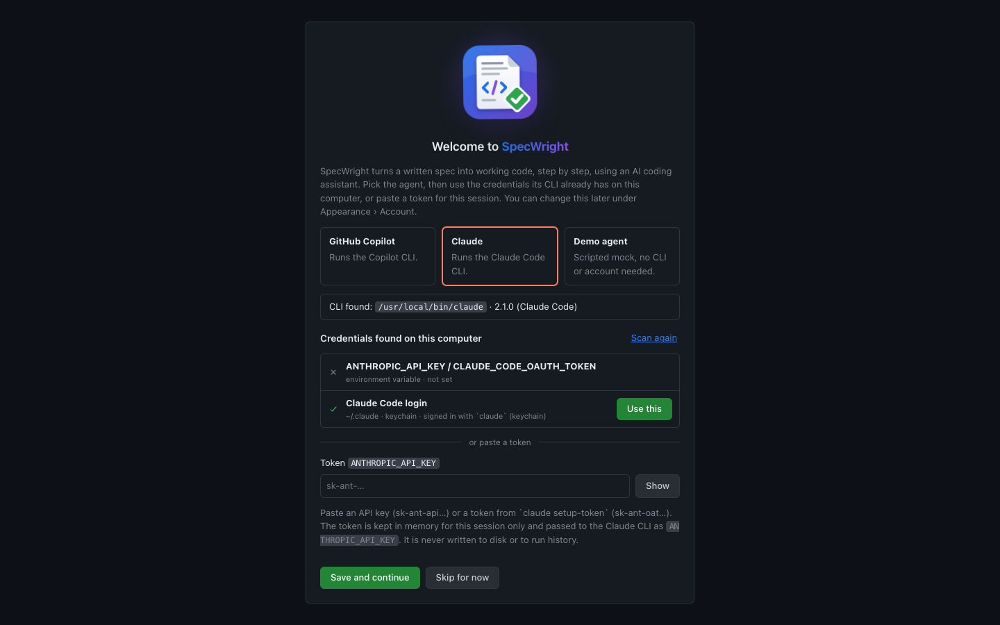

- **SET-1 (C)** The help text is long and inline code wraps mid-word. Apply X-5.
- **SET-2 (B)** After "Use this" the user lands in the wizard with no explanation of the three Build steps. Add a three-step strip ("1 Set up project · 2 Choose input · 3 Run workflow") on first run, dismissible, reusing the rail's progress (X-1).
- **SET-3 (C)** "Skip for now" is as prominent as the main action; make it a quiet link and say what is limited until an agent is chosen.

### 4.2 Development wizard

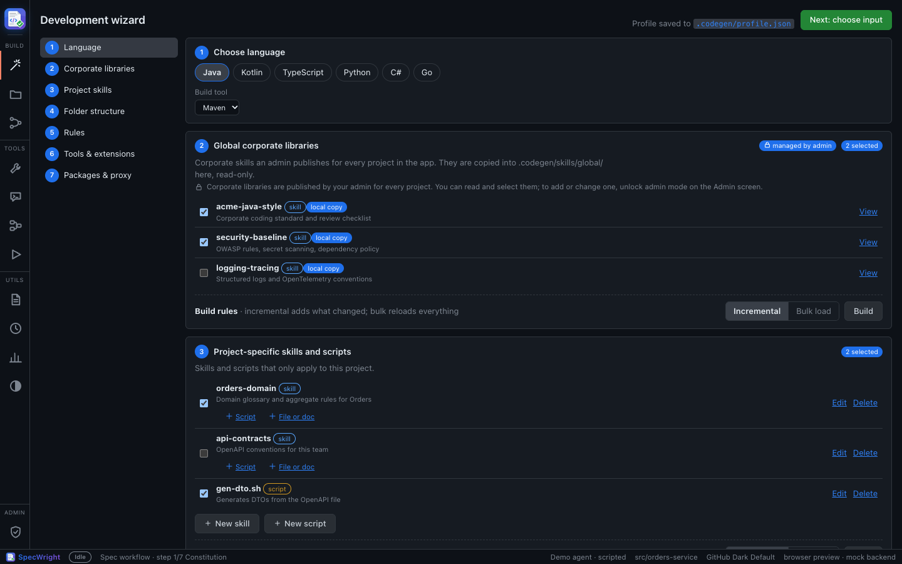

Full page: [03-wizard-full](screenshots/03-wizard-full.png) · Material skin: [35-wizard-material-skin](screenshots/35-wizard-material-skin.png) · 820 px: [36-wizard-820](screenshots/36-wizard-820.png)

- **WIZ-1 (B)** All seven sections are stacked in one 3,300 px scroll; the section list on the left only scrolls. Proposal: keep the section list as real navigation with status per section (done / needs attention / optional) and show **one section at a time** with "Back" and "Next" at the bottom, plus a "Show all" toggle that restores today's single scroll. The header button "Next: choose input" stays.

```
┌ Development wizard ───────────────── Profile saved ✓ ── [Next: choose input] ┐
│ 1 Language            ✓ │  3 · Project skills and scripts        2 selected │
│ 2 Corporate libraries ✓ │  ─────────────────────────────────────────────────│
│ 3 Project skills      ● │  ☑ orders-domain  skill          ✎  ＋  ⋯        │
│ 4 Folder structure    ✓ │  ☐ api-contracts  skill          ✎  ＋  ⋯        │
│ 5 Rules            3  ✓ │  ☑ gen-dto.sh     script         ✎      ⋯        │
│ 6 Tools & extensions  ! │  [+ New skill] [+ New script]                     │
│ 7 Packages & proxy    – │                                                   │
│ [ Show all sections ]   │  [Back]                         [Next: Folders →] │
└─────────────────────────┴───────────────────────────────────────────────────┘
```

- **WIZ-2 (B)** "Build rules: Incremental | Bulk load | Build" is repeated under sections 2, 3 and 4 with the same text; it is unclear whether they are three builds or one. Show it once, as a sticky footer of the wizard ("Build rules from sections 2–4"), or label each with what it builds. Check the handlers in `Wizard.jsx` first: if they are scoped per section, keep three but name them.
- **WIZ-3 (B)** Row actions are text links ("Edit Delete", "+ Script", "+ File or doc", "View"). Use icon buttons and an overflow menu (X-6); keep Delete behind confirmation.
- **WIZ-4 (C)** Section 6 repeats the Tools screen as tiles. Keep the tiles, add "Manage on the Tools screen ›", and make the tile sizes match `ToolTile` on the Tools screen.
- **WIZ-5 (C)** Section 7 is a long form of 15 fields. Group as collapsible blocks (Proxy, npm, pip, Go, Maven) that show their current value in the summary line ("npm: registry.npmjs.org (default)"); show "Check connections" results inline per row.
- **WIZ-6 (C)** "Profile saved to `.codegen/profile.json`" is the only save signal. Add a small "Saved · just now" state that changes to "Saving…" while writing.

### 4.3 Choose input

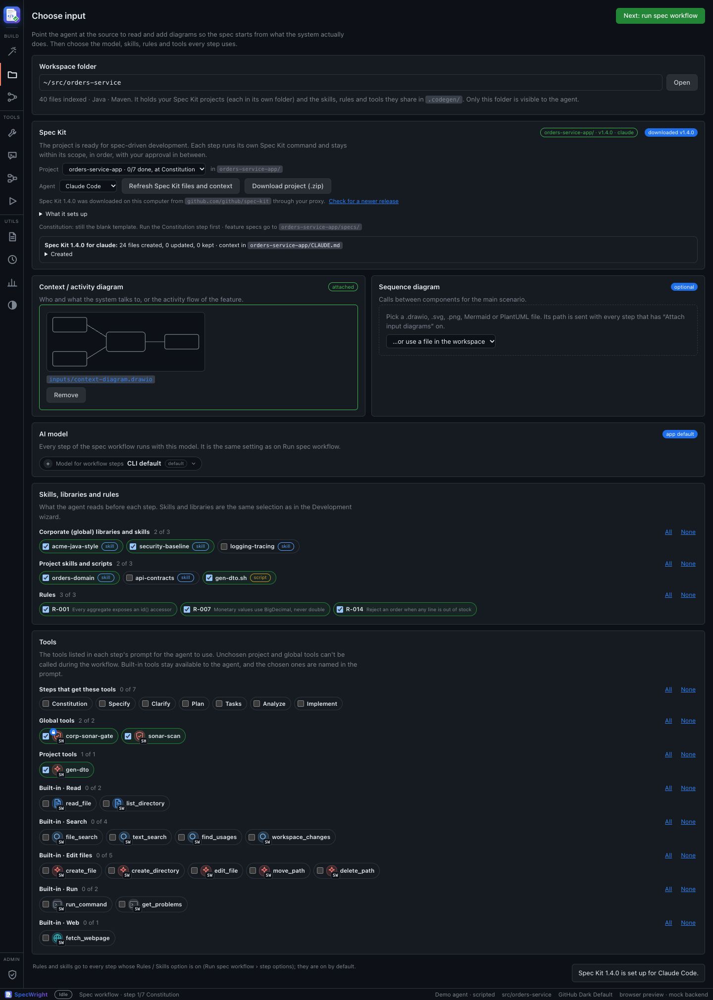

- **INP-1 (B)** Five cards, about 2,000 px. Tools alone lists 30 chips in 8 groups. Proposal: a summary header with jump links and counts ("Spec Kit ✓ · 1 diagram · model: CLI default · 4 skills, 3 rules · 3 tools on 0 steps"), and collapse "Tools" groups to one row each ("Built-in · Search — 0 of 4 ▸").
- **INP-2 (A)** "Steps that get these tools: 0 of 7" with tools ticked below means the ticked tools go to no step; nothing warns about it. Show a warning banner in the card when tools are selected and no step is, and the inverse.
- **INP-3 (B)** The Spec Kit card mixes status, three actions, a release note and a results box. Lay it out as: status line (project, version, integration) → one primary action (the label already adapts: "Set up Spec Kit" / "Refresh…" / "Add …") → secondary actions in a menu (Download project, Check for a newer release) → collapsible result.
- **INP-4 (C)** Diagram drop zones: make the whole dashed area a drop target with a visible "Drop a file or choose…" state and show accepted types as chips.
- **INP-5 (C)** The page says the model is "the same setting as on Run spec workflow"; show that with the source label from X-9 instead of a sentence.

### 4.4 Spec workflow

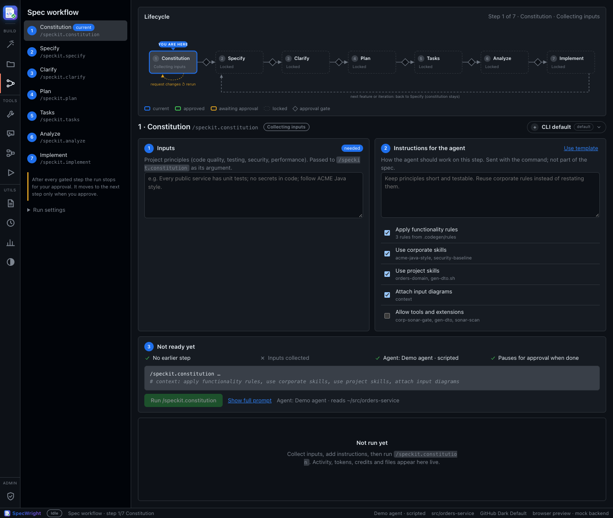

Running: [06-workflow-running](screenshots/06-workflow-running.png) · Awaiting approval: [07-workflow-approval](screenshots/07-workflow-approval.png) · 1024 px: [08-workflow-1024](screenshots/08-workflow-1024.png)

- **WF-1 (B)** The 260 px step list and the lifecycle diagram show the same seven steps and states; together they take the left column and the top 270 px. At 900 px height the Run button is below the fold ([05](screenshots/05-workflow-idle-full.png) is a full-page capture; in the window the page ends in the middle of the two cards). Proposal: one compact stepper across the top that carries state, with the full lifecycle diagram behind a "Show lifecycle" toggle (remembered). The left column is freed; "Run settings" moves to Settings › Runs with a link in the header (X-9).

```
┌ Spec workflow ─ orders-service-app ▾ ───────── model: CLI default ▾ ── ⚙ Run settings ┐
│ ①Constitution ─◇─ ②Specify ─◇─ ③Clarify ─◇─ ④Plan ─◇─ ⑤Tasks ─◇─ ⑥Analyze ─◇─ ⑦Implement │
│   ● awaiting      locked                                       [Show lifecycle ▾]      │
├────────────────────────────────────────────────────────────────────────────────────────┤
│ ⚠ Human approval needed — review the output below.  [Approve and continue] [Request changes] [Reject] │
├───────────────────────────────┬────────────────────────────────────────────────────────┤
│ 1 Inputs            collected │ Result  Activity · Files changed 1 · Debug 17          │
│ [ principles…               ] │ 3.0 s · 11k tokens · $0.016 · 2 tools · 1 file · 2% ctx │
│ 2 Instructions   Use template │ ↑ Asked claude-sonnet-5-5                               │
│ [ …                         ] │ ✎ Write …/constitution.md                    ok 105 ms │
│ ▸ Context: rules, 2 corporate │ 💬 Drafted a constitution with 3 core principles…       │
│   skills, 2 project skills, … │ ⏸ Paused for human approval                             │
│ 3 Ready ✓✓✓✓                  │                                                        │
│ [Run /speckit.constitution ⌘↵]│                                                        │
└───────────────────────────────┴────────────────────────────────────────────────────────┘
```

- **WF-2 (B)** Inputs, Instructions, the five context toggles, the readiness row, the command preview, the Run button and the results are stacked; during a run the live activity is below everything. Proposal: two columns as drawn: left = what you give (inputs, instructions, context toggles collapsed to a summary line, readiness, Run), right = what happens (stats, activity/files/debug tabs). Under 1100 px they stack, with the result first while a run is active.
- **WF-3 (A)** Readiness checks do not include "Spec Kit is set up for this project", so Run is enabled and fails with a toast (X-3). Add the check with a "Set up" link; disable Run until all checks pass and show the first failing reason next to the button.
- **WF-4 (B)** In the approval state the feedback field for "Request changes" sits in the Inputs card, far from the buttons ([07](screenshots/07-workflow-approval.png)). Put the feedback field inside the approval banner; it expands when "Request changes" is pressed and that button then reads "Send changes request". Keep "Reject" as a `.danger` quiet button with confirmation.
- **WF-5 (B)** The approval banner scrolls away with the page. Make it sticky under the header while the state is "awaiting approval", and show a diff summary ("1 file modified, +1 −2") with "Review files" that opens the Files changed tab.
- **WF-6 (C)** Lifecycle labels use 9–10 px text ("YOU ARE HERE", "request changes ↻ rerun", the legend). Apply X-5; move the legend into a tooltip on a "?" button.
- **WF-7 (C)** The stat chips next to "Lifecycle" (tokens, cost, tool calls, files) repeat the status bar. Keep them in the result panel only.
- **WF-8 (C)** Locked steps can be clicked and show "You are viewing … · Go to current step"; make that banner clearer: "Step 4 Plan is locked until Clarify is approved" with the button.

**Must keep.** Both ways to select a step (the stepper replaces the list; the lifecycle diagram stays clickable when shown); the loop arrow meaning (next iteration back to Specify, constitution stays); every run setting; cancel; loop and resume warnings.

### 4.5 Tools

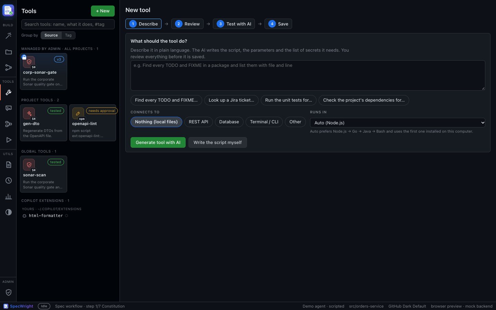

Review step: [10-tools-review-full](screenshots/10-tools-review-full.png) · Existing tool: [11-tools-detail-full](screenshots/11-tools-detail-full.png) · 1024 px: [12-tools-1024](screenshots/12-tools-1024.png)

- **TL-1 (B)** The tool list is a tile grid squeezed into a 300 px sidebar; descriptions are cut after two short lines and status pills overflow the tile ("needs approval" at 1024 px). Proposal: a dense list row per tool in the sidebar (icon, name, one-line description, status dot, runtime tag), and a full-width **tile gallery when no tool is open** with filters (source, tag, status). Group headers stay.
- **TL-2 (B)** When editing an existing tool the Tags field appears above the "Edit tool" heading, detached from the form ([11](screenshots/11-tools-detail-full.png)). Move Tags into the header row of the editor next to the name, in both new and edit modes.
- **TL-3 (B)** Review is one long page (generated tool, parameters, output shape, dependencies, secrets, script, ask AI), about 1,700 px. Proposal: keep the four-step stepper, and inside Review use tabs: **Overview** (name, description, parameters) · **Script** (command template, code, "Ask AI to change something") · **Data** (output shape) · **Dependencies** · **Secrets and permissions**, each tab with a count or a warning dot. "Back" and "Next: test with AI" stay in a sticky footer.
- **TL-4 (B)** The script viewer is a plain block with wrapped long lines. Use the `FileView` component (line numbers, no wrap, copy, zoom) and show a diff when the AI changes the script ("Review the changed script" exists; make it a side-by-side or inline diff).
- **TL-5 (C)** The stepper steps are clickable but look like status chips; show completed steps with a tick (already done for Describe) and disable future steps with a reason tooltip.
- **TL-6 (C)** The Copilot extensions group is a small mono text row unlike the other groups; render it with the same row component and an "ext" tag.
- **TL-7 (C)** "Connects to" and "Runs in" in Describe: add one line under the selected option saying what it implies (e.g. "REST API: the tool may need a secret; you will be asked in Review").

### 4.6 Prompt playground

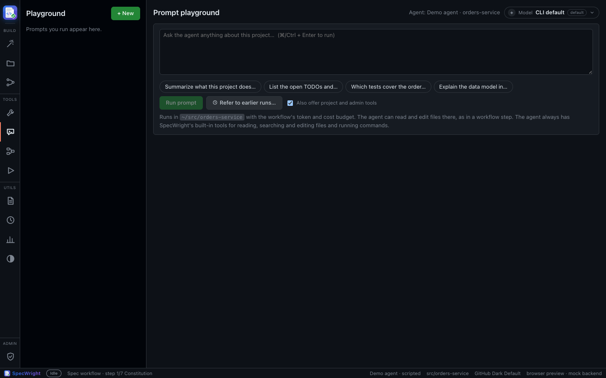

With a run: [14-playground-run](screenshots/14-playground-run.png)

- **PG-1 (B)** The prompt box is at the top and results grow below, so in a long conversation the box scrolls away. Proposal: a conversation layout: history scrolls, the composer is docked at the bottom with model, attachments, "Also offer project and admin tools" and "Refer to earlier runs…" in a toolbar row; `⌘Enter` sends.
- **PG-2 (B)** Run titles in the list are truncated to one line; add a second line (first 80 characters of the prompt, time, status) and the resizable pane (X-4).
- **PG-3 (C)** "Refer to earlier runs" opens a picker; show the chosen runs as removable chips in the composer (a "Continuing from:" line exists; make it chips).
- **PG-4 (C)** Tool usage and "Full activity, files changed and raw events" are collapsed disclosures; show a compact timeline of tool calls inline with the answer, expandable per call.
- **PG-5 (C)** Empty state: add 3–4 starter prompts for this project (the Files view has quick prompts that can be reused).

### 4.7 Flow designer

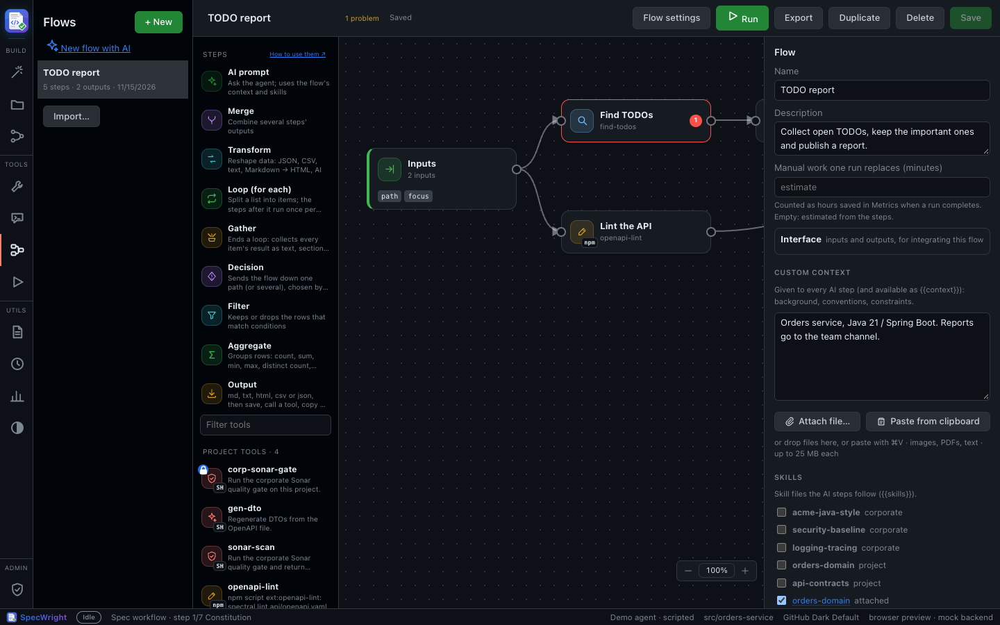

Step selected: [16-flows-node-inspector](screenshots/16-flows-node-inspector.png) · Flow settings: [17-flows-settings](screenshots/17-flows-settings.png) · New flow with AI: [18-flows-new-with-ai](screenshots/18-flows-new-with-ai.png) · Full palette: [19-flows-palette-full](screenshots/19-flows-palette-full.png) · 1024 px: [20-flows-1024](screenshots/20-flows-1024.png) · 1280×720: [21-flows-1280x720](screenshots/21-flows-1280x720.png) · Light: [22-flows-light](screenshots/22-flows-light.png)

- **FL-1 (A)** Canvas space. Four columns (rail, flow list 230, palette 210, inspector 340) leave 610 px for the canvas at 1440 px and the example flow already runs off the right edge. Proposal (with X-4): the flow list becomes a dropdown in the header; palette and inspector are collapsible and resizable; add **Fit to view**, **zoom to selection**, a **minimap** (bottom right, toggle), panning with Space+drag or middle mouse, and `⌘+ / ⌘− / ⌘0`.

```
┌ ⧉ TODO report ▾   ● 1 problem   Saved        [Flow settings] [▷ Run] [Save ⌘S] [⋯] ┐
├──────────┬────────────────────────────────────────────────────────┬────────────────┤
│ Steps  « │                                                        │ » Find TODOs   │
│ 🔍 filter│   [Inputs]──▶[Find TODOs ●1]──▶[Combine]──▶[Report]    │ Tool · todos   │
│ ◆ AI     │        └────▶[Lint the API]────┘                       │ ⚠ tool missing │
│ ◆ Merge  │                                                        │ ▸ Basics       │
│ …        │                                                        │ ▾ Arguments    │
│ Tools ▾  │                                            ┌───────┐   │ ▸ Data         │
│ project 4│                              [− 100% + ⤢]  │minimap│   │ ▸ Review, note │
└──────────┴────────────────────────────────────────────┴───────┴───┴────────────────┘
```

- **FL-2 (A)** Header actions (X-6): Save is the only primary; Run is a default button with the play icon and is disabled with a reason while there are problems or unsaved changes ("Save first" or auto-save before run, as today's behavior dictates); Export, Duplicate, Import, Delete move into `⋯`. "Saved" becomes a state indicator ("Unsaved changes" in warn color, "Saving…", "Saved").
- **FL-3 (A)** Problems. "1 problem" is 11 px warn-colored text. Make it a button that opens a problems popover listing each problem with "Go to step"; selecting one selects the node and scrolls the inspector to the field. The red node border and count badge stay.
- **FL-4 (B)** Inspector. It is a single long form; for a tool step it holds an error, step id, title, tool, argument mode, arguments, data panel, review checkbox, note. "Step id" sits above and to the right of "Title", misaligned ([16](screenshots/16-flows-node-inspector.png)). Proposal: a fixed header (icon, title editable in place, type, `⋯` with Copy, Duplicate, Copy to a new flow, Delete) and collapsible sections that remember their state: **Basics** (title, step id with its "Later steps read it as…" help in a popover), **Settings** (type-specific), **Data** (gets/gives), **Review and note**. Errors appear at the top and next to the field they concern.
- **FL-5 (B)** Palette. Nine step types with two-line truncated descriptions, then 18 tools, in a 210 px column ([19](screenshots/19-flows-palette-full.png)). Proposal: one search box for steps and tools; step types as compact rows (icon + name) with the description in a hover/focus card that also links to the Flow step guide; tools grouped (project, built-in by category) and collapsible; recently used on top.
- **FL-6 (B)** Connecting. Ports are 12 px circles and the only hint is a `title`. Enlarge the hit area to 24 px, highlight valid targets while dragging, show why a target is invalid ("That would make a loop" is a toast today; show it at the cursor), and add "+" on an output port to pick the next step from a small menu (inserts and connects).
- **FL-7 (B)** No undo. Deleting steps shows "Deleted N steps." with no way back. Add an undo/redo stack for canvas edits (`⌘Z` / `⇧⌘Z`) and an "Undo" button in the delete toast.
- **FL-8 (C)** "New flow with AI" opens as a panel over the palette and canvas while the inspector stays visible behind it ([18](screenshots/18-flows-new-with-ai.png)). Make it a centered modal or a full-width sheet with the options compared side by side (shape, uses, trial-run result), since choosing between options is its main job.
- **FL-9 (C)** The flow list shows the same example three times with identical names ([19](screenshots/19-flows-palette-full.png)) because "Try it in the designer" saves a new copy each time. Name copies "… (2)", or reopen the existing example.
- **FL-10 (C)** Secret inputs: the source choice (ask, keychain, environment variable, auto) is a strong feature hidden in the Inputs step inspector. Show a lock icon and the source on the Inputs node chip (`token 🔒 keychain`) and in Run flows.
- **FL-11 (C)** Light theme: step type icons lose contrast on pale tiles ([22](screenshots/22-flows-light.png)); check with the script from X-10.

**Must keep.** Everything in the Flow designer row of 2.3, in particular: click-to-add after the selected step, copy/paste across flows, band selection, the data panel's click-to-insert, trial runs with sample data, HTML preview, interface as JSON Schema.

### 4.8 Run flows

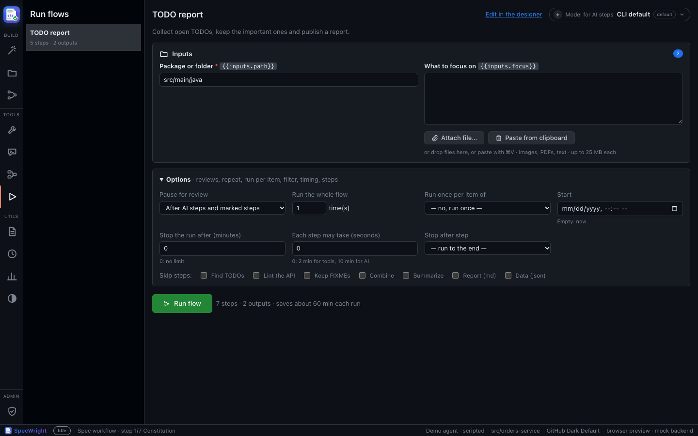

Review pause: [24-flowrun-review](screenshots/24-flowrun-review.png) · 820 px: [25-flowrun-820](screenshots/25-flowrun-820.png)

The review panel is the best-designed part of the app: clear state, three plain choices, and four ways to improve the result. Proposals build on it.

- **FR-1 (B)** Options are ten controls in a collapsed disclosure with a summary that lists categories ("reviews, repeat, run per item, filter, timing, steps"). Show the **non-default values** in the summary instead ("Review: after AI steps · 1 time · no limits"), group the body into Review, Repeat, Limits, Steps, and replace "0" meaning "no limit" with an empty field and the placeholder "No limit".
- **FR-2 (B)** Run list: runs are nested under their flow with only a timestamp; the selected run's row truncates ("11/15/2026, 1:40:10 PM" wraps). Use relative time ("2 min ago") with the full time in the tooltip, a status icon, and duration. Add a filter (All / Waiting / Running / Failed).
- **FR-3 (B)** Step counts differ ("5 steps" vs "7 steps"), see X-11.
- **FR-4 (B)** During a run the steps list is a flat list; for flows with decisions and loops it does not show the path taken. Add a small read-only graph (the designer canvas in view mode, nodes colored by status) as a tab next to the steps list.
- **FR-5 (C)** The progress ring says "33%" computed from steps; add "step 3 of 4" under it, and show the estimate "Saves about 30 min" only once (it appears in setup and in the side panel).
- **FR-6 (C)** "Stop" in the header and "Stop the flow" in the review panel do the same thing; keep both but give the header one the `.danger` quiet style and a confirmation when steps have side effects (outputs that call tools or write files).
- **FR-7 (C)** Outputs: when a run completes, lead with the outputs (cards with preview, copy, open, show in Finder) above the steps list; today they follow the steps.
- **FR-8 (C)** The review tabs ("Refine with AI", "Run a command", "Edit the result", "Change settings and run again") have no description until opened; add a one-line hint under the tab row for the selected tab.
- **FR-9 (A)** The status bar and rail give no sign that a flow is waiting for the user when another view is open (X-8, X-1).

### 4.9 Flow step guide

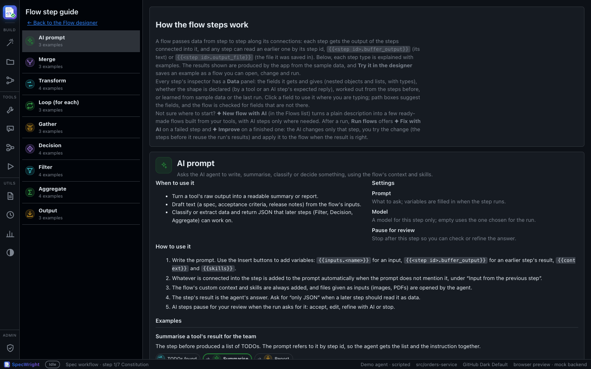

- **FG-1 (B)** It is reachable only through the 10 px "How to use them ↗" link in the designer palette and the "?" links in the inspector. Add it to the rail (X-1) and to the command palette, and open it in a **side panel** from the inspector so the user keeps the canvas in view; the full page stays.
- **FG-2 (C)** "Try it in the designer" creates a new flow each time (FL-9).

### 4.10 Project files

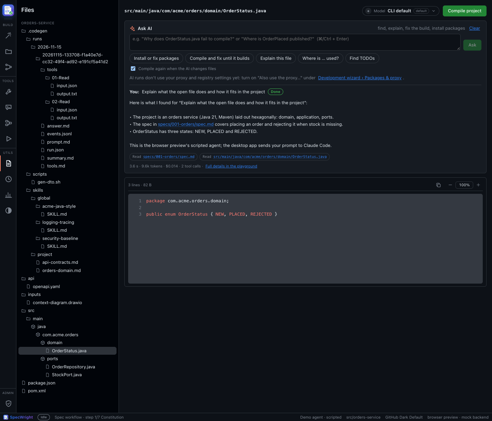

- **FI-1 (B)** The Ask AI card sits above the file viewer and grows with each answer, pushing the code down; a three-line file gets a small viewer under a large card. Proposal: Ask AI becomes a right-hand panel (collapsible, resizable; under 1100 px a bottom drawer) so file and conversation are side by side. Quick prompts stay as chips; "Compile again when the AI changes files" moves next to "Compile project".
- **FI-2 (B)** The tree has no search or filter and opens fully expanded, with `.codegen/runs/…` first. Add a filter box (name match, `⌘P` to focus), collapse `.codegen` by default, remember expanded folders, and show changed files (from the last run) with a dot.
- **FI-3 (C)** No tabs or history: opening a link from an answer replaces the file. Add back/forward and a short "recent files" list in the header.
- **FI-4 (C)** The path header is plain mono text; make it a breadcrumb with copy path and "Reveal in Finder".
- **FI-5 (C)** Compilation output appears below; show its status in the header button ("Compile project ✓ 12 s" / "✗ 3 errors") with a jump link.

### 4.11 History

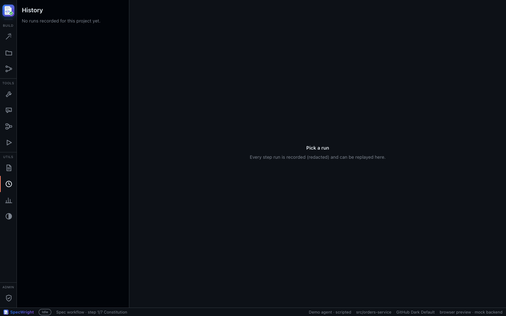

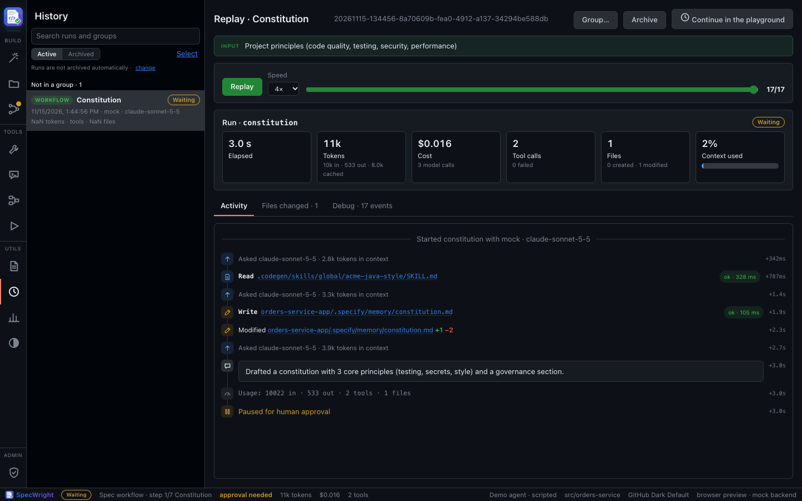

- **HI-1 (A)** A run that is waiting shows "NaN tokens · tools · NaN files" in the list ([29](screenshots/29-history-replay.png); `History.jsx:53` adds `usage` fields that are missing for unfinished runs). Guard missing values and show "in progress" instead. (Seen with the mock backend; check the real backend's records for runs without a final usage event.)
- **HI-2 (B)** The run id (a 50-character timestamp+UUID) is the page subtitle. Show a short id with a copy button; keep the full id in the tooltip and in "Copy run id".
- **HI-3 (B)** List rows: add kind icon (workflow / flow / playground / ask), relative time, duration, and filters by kind and status next to Active/Archived. "Select" and "Group…" become a selection toolbar that appears when rows are ticked.
- **HI-4 (C)** Replay controls: label the scrubber with the event under the cursor, add step back/forward buttons and Space to play/pause.
- **HI-5 (C)** Empty state per X-7. The housekeeping note "Runs are not archived automatically · change" links to Settings › Runs (X-9).

### 4.12 Metrics

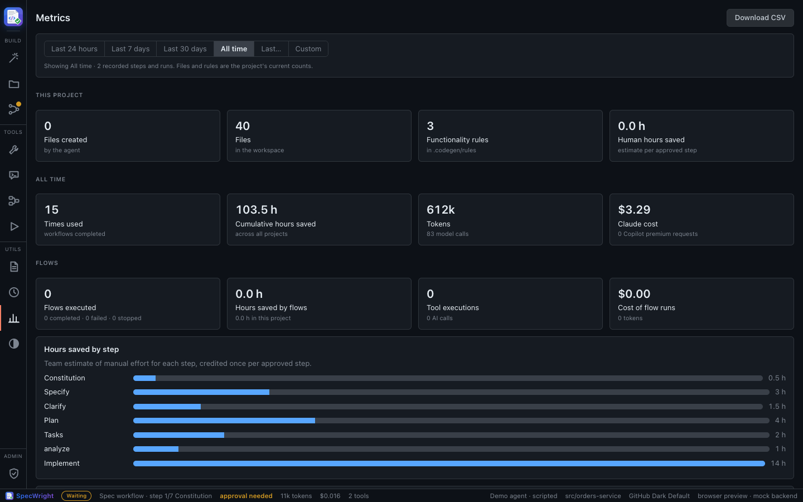

- **ME-1 (B)** Twelve equal tiles in three groups, many showing 0, with no trend. Proposal: a top row of four headline numbers for the chosen range (hours saved, runs, cost, tokens) each with a sparkline and change against the previous period; below, the per-group tiles with zero-value tiles dimmed. Charts must follow the theme tokens and have a table alternative.
- **ME-2 (B)** The range note says "Files and rules are the project's current counts", meaning some tiles ignore the range. Mark those tiles with a "now" tag instead of a sentence.
- **ME-3 (C)** "Hours saved by step" uses full-width bars where the track looks like data; lighten the track, right-align values, and fix the label case ("analyze" is lower-case, the others are capitalized).
- **ME-4 (C)** "Last…" and "Custom" open extra inputs; show the active range as text in the bar ("12 Nov 09:00 – now") and keep the CSV button stating what it exports ("Download CSV · 2 runs").

### 4.13 Appearance (to become Settings)

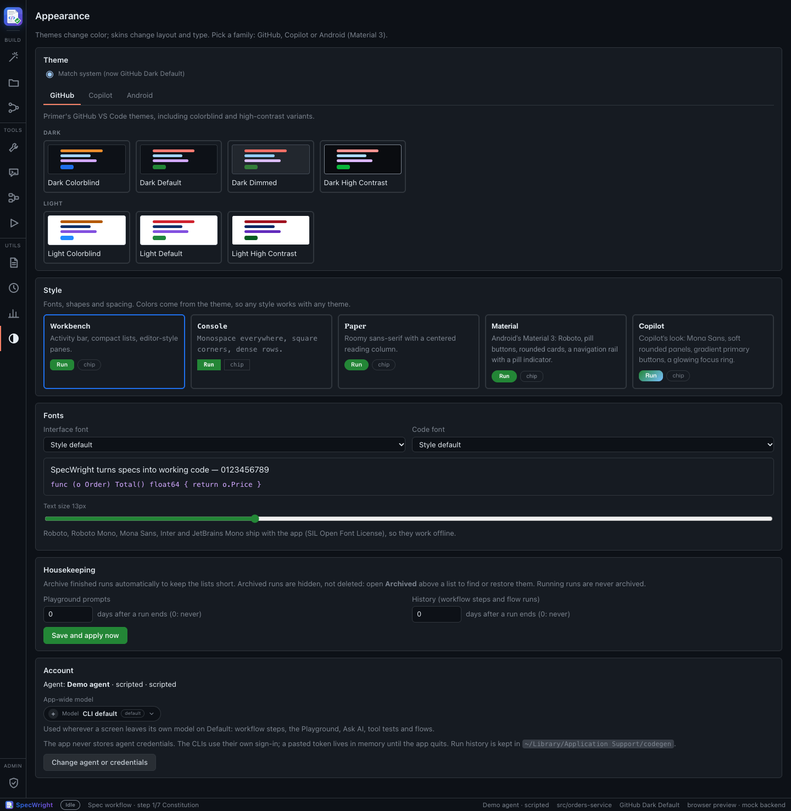

- **AP-1 (B)** Restructure into Settings tabs (X-9). The Appearance tab keeps theme, style, fonts and text size exactly as they are.
- **AP-2 (C)** The "Match system" radio is separate from the theme tiles, so it is unclear that picking a tile turns it off. Make it a three-way control: System · Dark · Light, with the tile grids choosing the dark and light themes used.
- **AP-3 (C)** Text size is an unlabeled slider (13 px shown in the caption). Add tick marks (11–18), a reset, and `⌘+`/`⌘−` app-wide zoom outside the file viewer.
- **AP-4 (C)** Style cards: show a small live preview (button, chip, list row, input) as they do now, and add the name of the font each uses.

### 4.14 Admin

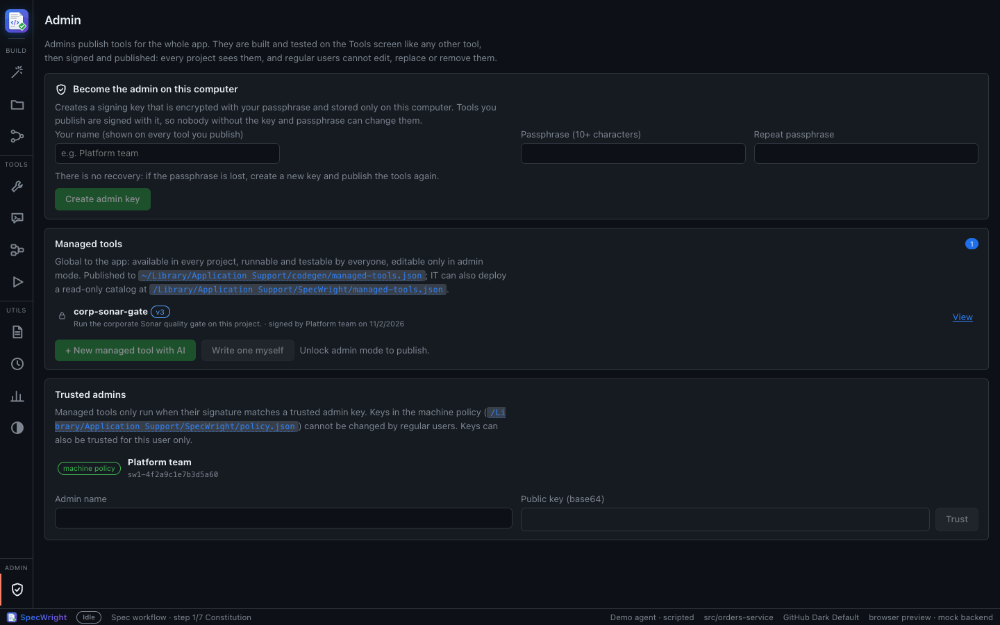

Light: [34-admin-light](screenshots/34-admin-light.png)

- **AD-1 (B)** Locked state: buttons are disabled with "Unlock admin mode to publish." far from the unlock field. Put one lock banner at the top ("Admin mode is locked · [passphrase] [Unlock]") and enable the rest when unlocked; show the session state ("Unlocked as Platform team · locks when the app quits · [Lock]").
- **AD-2 (B)** First-time "Become the admin on this computer" has no passphrase strength or match feedback until submit (a toast says "The passphrases do not match."). Validate inline (X-3).
- **AD-3 (C)** Trusted admins: the public key field takes raw base64; add paste validation, a fingerprint (first/last 8 characters) in the list, and confirmation on remove.
- **AD-4 (C)** Show the admin state in the status bar and on the rail icon (open/closed lock).

### 4.15 Overlays and prompts

- **OV-1 (A)** Secret and permission prompts interrupt a run from any view. Check that each: names the flow/tool and step asking; traps focus; cannot be dismissed by a stray click outside; and shows what happens on deny. Add the flow run's name as a link that opens the run behind the prompt.
- **OV-2 (B)** Permission prompt: "Allow once / Allow for this run / Deny" are three equal buttons. Make "Allow once" the default action, "Deny" a `.danger` quiet button, and show the exact command or path in a mono block with copy.
- **OV-3 (B)** Secret prompt: show where the value will go ("passed to the tool as `SONAR_TOKEN`; never saved or sent to the model") above the field, a show/hide eye, and the two remember options as radio choices with "Don't remember" as default.
- **OV-4 (C)** File preview panel: resizable width (X-4), and remember it.
- **OV-5 (C)** Rules side drawer and bulk editor, library editor: use the shared `Modal`/drawer wrapper (X-10) and show unsaved-changes protection on Esc.
- **OV-6 (C)** Model picker: show the source of the default (X-9) and recently used models first.

## 5. Design system additions

| Token / component | Purpose |
|---|---|
| `--fs-xs … --fs-xl` | Type scale relative to the user's text size (X-5). |
| `--radius-sm`, `--radius`, `--radius-lg` | Three radii plus pill (X-11). |
| `--space-1 … --space-6` (4, 8, 12, 16, 24, 32 px, scaled by skin) | Replace ad-hoc paddings and inline styles. |
| `--bp-compact` 1100 px, `--bp-narrow` 860 px | The only two breakpoints. |
| `--z-popover`, `--z-drawer`, `--z-modal`, `--z-toast` | One stacking order (the toast is `z-index: 30` today). |
| `SplitPane` | Resizable, collapsible panes with saved sizes (X-4). |
| `Menu`, `IconButton`, `Tooltip` | Overflow actions and labeled icon buttons (X-6). |
| `Tabs`, `Stepper` | One implementation for Tools, Workflow, History, Settings, review tabs. |
| `Banner`, `Field`, toast kinds | Feedback levels (X-3). |
| `EmptyState`, skeleton rows | X-7. |
| `Modal`, `Drawer` | Focus trap, Esc, focus return (X-10). |
| `CommandPalette`, `shortcuts.js` | X-2. |

State colors stay as they are: `--info` current/running, `--ok` approved/completed, `--warn` waiting for the user, `--error` failed, `--faint` locked/pending. Every status also carries text or an icon.

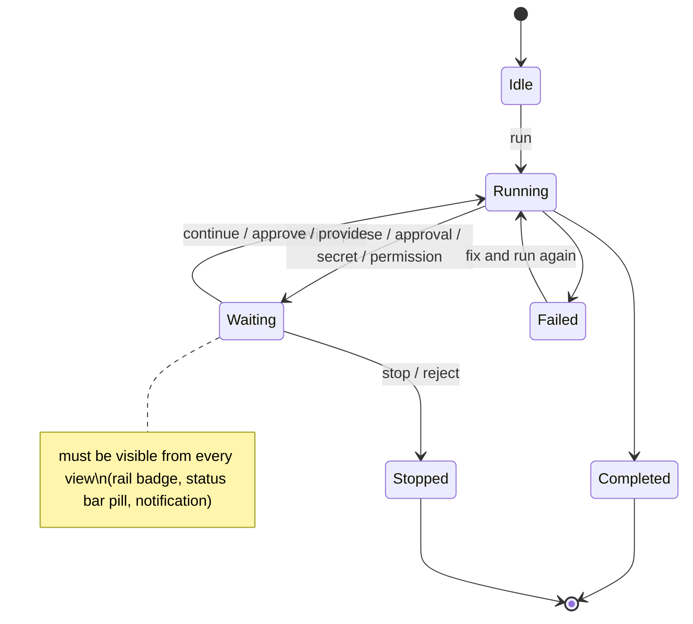

## 6. Phased plan

Order matters: phase 1 creates the components the later phases use. Each phase should be its own PR and leave the app fully working.

| Phase | Items | Why first |
|---|---|---|
| **1 Foundations** | X-11 components (`SplitPane`, `Menu`, `IconButton`, `Tooltip`, `Tabs`, `Banner`, `Field`, `EmptyState`, `Modal`), tokens (X-5 type scale, radii, spacing, breakpoints), toast kinds (X-3) | Everything else is built from these. No visible redesign yet; screenshots should change only slightly. |
| **2 Correctness and feedback** | WF-3, INP-2, HI-1, X-3 banners and inline errors, FR-3/X-11 counts, FL-3 problems popover, FR-9/X-8 cross-view waiting state, OV-1 | Fixes the cases where the UI misleads. |
| **3 Navigation and shell** | X-1 rail, X-8 status bar, X-2 palette and shortcuts, X-9 Settings | Changes how every screen is reached. |
| **4 Layout** | X-4 on all views, WF-1/WF-2, FL-1/FL-2, FI-1, PG-1, TL-1 | The largest visual change; do one view per commit. |
| **5 Screen polish** | Remaining WIZ, INP, WF, TL, PG, FL, FR, FG, FI, HI, ME, AP, AD, OV items | Independent of each other. |
| **6 Accessibility** | X-10 canvas keyboard model, contrast script, live regions, target sizes | Needs the phase 4 layouts in place. |

Acceptance for every phase:
- `npm --prefix frontend run build` succeeds; existing frontend and Go tests pass.
- Every row of section 2.3 was exercised in the mock UI, in one dark and one light theme, and in the `workbench` and `material` skins.
- Screens were checked at 1440×900, 1280×720 and 1024×700.
- Screenshots in `screenshots/` were re-captured for the changed views.

## 7. Re-capturing the screenshots

The screenshots were taken with headless Chrome against the mock UI. The driver is in [tools/shoot.mjs](tools/shoot.mjs) (Node 22+, Google Chrome installed; it uses the DevTools protocol, no packages).

```bash
npm --prefix frontend run dev
```

```bash
node docs/ui-review/tools/shoot.mjs docs/ui-review/tools/plan.example.json docs/ui-review/screenshots
```

A plan is a JSON list; each item sets the view and theme through `localStorage`, optionally runs small scripts to click through to a state, and saves `<name>.png`. Fields: `name`, `view`, `setupDone`, `reset`, `theme`, `scheme` (`dark`/`light`), `skin`, `w`, `h`, `js[]`, `full` (whole page), `wait`, `step`. See [tools/plan.example.json](tools/plan.example.json).

Things learned while capturing:
- Rail buttons are found by `aria-label` (e.g. "Run spec workflow", "Run history and replay").
- A workflow step only runs after "Set up Spec Kit" on Choose input.
- The mock flow "TODO report" references a tool `find-todos` that the mock project does not have, so it shows a problem and cannot run; use the Flow step guide's "Try it in the designer" example to capture a running flow. Fixing the mock data would make the demo flow usable.

## 8. Limits of this review

- Reviewed in the browser mock, not the packaged Wails app: native dialogs (folder picker, Finder reveal), window chrome and real agent timing were not seen.
- Not captured as screenshots, reviewed from source only: secret prompt, permission prompt, rules editors, library editor, built-in tool page, Copilot extension page, admin unlocked state, tool test step, flow run completed/failed states, compile output.
- Color contrast was not measured; X-10 proposes a script to do it for all themes.
- No user testing or usage data informed the priorities; severities are the reviewer's judgment.
- Windows was not looked at (fonts, scrollbars, `Ctrl` shortcuts); check phase 3 and 4 there.

## 9. Screenshot index

| File | Shows |
|---|---|
| 01-setup | First-run agent setup |
| 02-wizard, 03-wizard-full | Development wizard, window and full page |
| 04-inputs-full | Choose input after Spec Kit setup, full page |
| 05-workflow-idle-full | Spec workflow before a run, full page |
| 06-workflow-running, 07-workflow-approval | Step running; awaiting approval |
| 08-workflow-1024 | Workflow at 1024 px (clipped lifecycle) |
| 09-tools, 10-tools-review-full, 11-tools-detail-full, 12-tools-1024 | Tools: new, review step, existing tool, 1024 px |
| 13-playground, 14-playground-run | Playground empty and with a run |
| 15-flows … 22-flows-light | Flow designer states and sizes |
| 23-flowrun-setup-options, 24-flowrun-review, 25-flowrun-820 | Run flows: setup, review pause, 820 px |
| 26-flowguide | Flow step guide |
| 27-files-ask-ai | Project files with an Ask AI answer |
| 28-history-empty, 29-history-replay | History |
| 30-metrics | Metrics after one run |
| 31-appearance, 32-appearance-full | Appearance |
| 33-admin, 34-admin-light | Admin, dark and light |
| 35-wizard-material-skin, 36-wizard-820 | Wizard in the Material skin; at 820 px |
